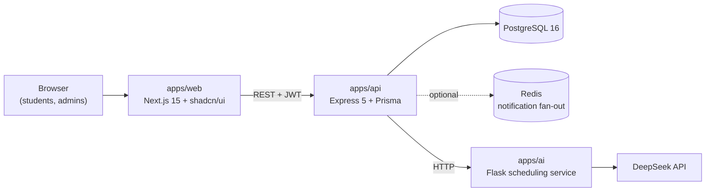

<div align="center">

# Cognitia

**An academic companion for engineering university students.**
Share notes, ask and answer questions, practice with timed model tests, compete in contests and plan your study week, all in one place.


</div>

---

> **Status: active rework (v0.2).** Cognitia started as a CSE 406 Software Development Sessional project in 2025. This monorepo is where it's being rebuilt into a production-grade product. Security fixes and the new Study Engine are in progress. See the [roadmap](#roadmap).

## Features

| Area | What students can do |
|---|---|
| **Notes** | Upload PDF notes into groups, keep them private or make them public, browse and read classmates' public notes in the app |
| **Q&A** | Ask course questions, answer, upvote and downvote, filter by subject |
| **Model tests** | Take timed MCQ tests from a shared question bank, resume unfinished attempts, review answers with explanations, track history |
| **Contests** | Quizzes, mock CTs, weekly challenges, aptitude and olympiad rounds with five question types, negative marking and partial credit. Fixed or flexible time windows; public, institution-only or invite-only access. Autosaving contest arena, live and final standings, answer review with explanations, practice mode, certificates, and Elo-style contest ratings with university rankings. Admins get an organizer console for authoring, clarifications, announcements, integrity checks, rejudging and CSV export ([design](docs/product/contests.md)) |
| **Study plan** | Track tasks with priorities and due dates, and plan study sessions. AI scheduling is being rebuilt as part of the Study Engine |
| **Notifications** | Get updates on answers, votes, contests, deadlines and sign-ins |
| **Profiles** | Manage academic profile details (institution, level and term, major) and avatar |

## Architecture



- **`apps/web`**: Next.js App Router frontend with Tailwind CSS, shadcn/ui (Radix) and Framer Motion.
- **`apps/api`**: Express REST API, Prisma ORM on PostgreSQL, JWT auth with Google OAuth, email OTP verification, a notification WebSocket endpoint and a per-minute job that auto-submits expired tests and runs the contest lifecycle (reminders, auto-submit, finalizing, ratings). Endpoint references are in [`apps/api/docs/api/`](apps/api/docs/api/).
- **`apps/ai`**: Flask service that builds study schedules with DeepSeek. It falls back to a local heuristic when no API key is set.

## Repository layout

```
Cognitia/
├── apps/
│   ├── web/            # Next.js frontend
│   ├── api/            # Express + Prisma backend
│   │   └── prisma/     # schema, migrations, seed data
│   └── ai/             # Flask + DeepSeek scheduling service
├── docs/
│   └── product/        # product and design docs (Study Engine, Contests)
├── scripts/            # cross-platform dev helpers
├── docker-compose.yml  # optional local PostgreSQL
└── package.json        # one-command scripts for the whole stack
```

## Getting started

### Prerequisites

- Node.js 20 or newer
- Python 3.10 or newer
- PostgreSQL 16, either installed locally or started with `docker compose up -d db`

### 1. Install

```bash
git clone https://github.com/shahriar-ahmed-seam/Cognitia.git
cd Cognitia
npm install        # root tooling
npm run setup      # installs api, web and the AI virtualenv
```

### 2. Configure

```bash
cp apps/api/.env.example apps/api/.env
cp apps/web/.env.example apps/web/.env.local
cp apps/ai/.env.example  apps/ai/.env
```

At minimum, set these three:
- `DATABASE_URL` in `apps/api/.env`
- `JWT_SECRET` in `apps/api/.env` (generate one with `openssl rand -hex 32`)
- `DEEPSEEK_API_KEY` in `apps/ai/.env`. This one is optional; without it the AI service uses its local heuristic.

When email isn't configured, OTP codes are printed to the API console in development.

### 3. Create and seed the database

```bash
npm run db:migrate
npm run db:seed
```

### 4. Run everything

```bash
npm run dev
```

| Service | URL |
|---|---|
| Web app | http://localhost:3000 |
| API | http://localhost:3001 (health check at `/health`) |
| AI service | http://localhost:5000 (health check at `/health`) |

### Demo accounts

The seed creates a realistic dataset for a Level 3 CSE section. It includes courses, notes (real PDFs), Q&A threads, a question bank, model tests, past, live and upcoming contests, tasks, study sessions and notifications. All accounts use the password **`Cognitia@123`**.

| Role | Email |
|---|---|
| Admin (contest organizer) | `admin@cognitia.test` |
| Student | `student@cognitia.test` |
| Classmates | `tasnim@`, `arif@`, `mehjabin@`, `rakib@`, `anika@`, `fahim@`, `nusrat@`, `tanvir@`, `sadia@cognitia.test` |
| Students at other universities | `zarif@` (CUET), `mahir@` (KUET), `farzana@` (DU), `shafin@` (SUST) and 12 more `@cognitia.test` accounts |

These accounts exist only in your local database.

The seed has contests in every state, with times relative to when you seed:
- two live contests: a fixed 3-hour challenge, and a flexible mock CT with a 30-minute personal timer
- upcoming contests, including an invite-only one (access code `SECA-2025`) and a BUET-only one
- a finished contest waiting for the organizer to review and publish results
- four rated contests with published results and ratings
- one cancelled contest and one draft

Re-run `npm run db:seed` to reset them.

## Scripts

Run from the repository root:

| Command | Description |
|---|---|
| `npm run dev` | Start web, API and AI together |
| `npm run dev:web` / `dev:api` / `dev:ai` | Start one service |
| `npm run setup` | Install all app dependencies and the AI virtualenv |
| `npm run db:migrate` | Apply Prisma migrations |
| `npm run db:seed` | Wipe and reseed the demo data |
| `npm run db:reset` | Drop the database, re-apply migrations and reseed |
| `npm run db:studio` | Open Prisma Studio |

## Roadmap

The next major piece is the **Study Engine**. It replaces the to-do-list study plan with something students keep using all semester:

- **Section-shared deadlines.** The CR posts a deadline once and everyone gets it, including students who never type anything.
- **Deadline capture from pasted WhatsApp messages.** Banglish is welcome, and DeepSeek parses the text.
- **A "Right Now" card** that says what to do next and why, driven by a tested rule-based ranking engine.
- **Low-effort tracking** without guilt: one-tap logging, a welcome-back screen after absences, and "rescue my week" plans.
- **A course hub** with CT marks, grade projection, attendance and previous years' questions.

Read the full product definition in [docs/product/study-engine.md](docs/product/study-engine.md).

## Team

Built by **Shahriar Ahmed Seam** ([@shahriar-ahmed-seam](https://github.com/shahriar-ahmed-seam)), **Swarup Sidhartho Mondol** and **Taky Shaharair** as part of the CSE 406 Software Development Sessional. The full commit history from the original repositories is preserved in this monorepo.
